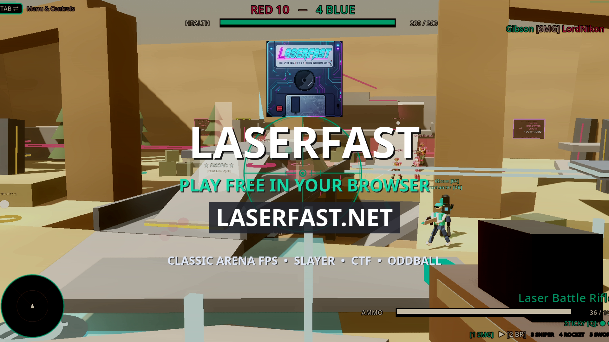
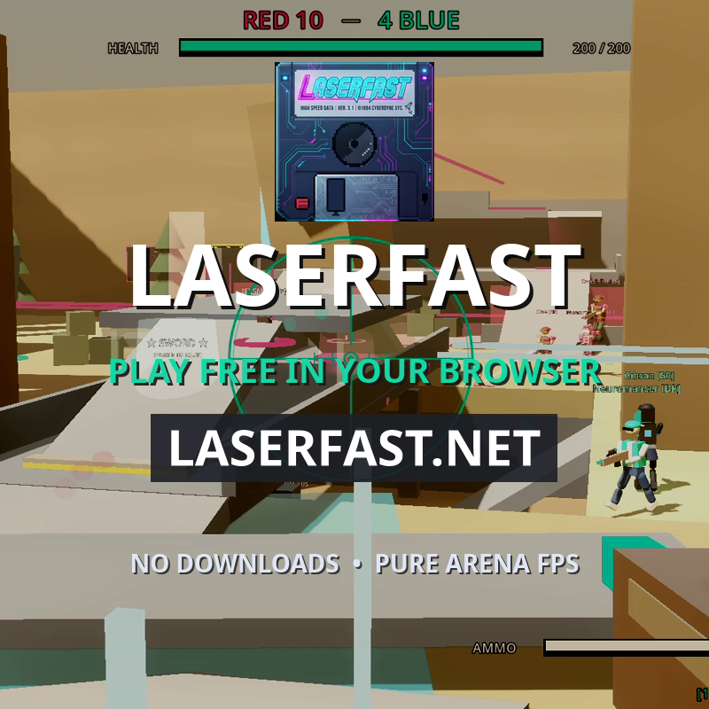
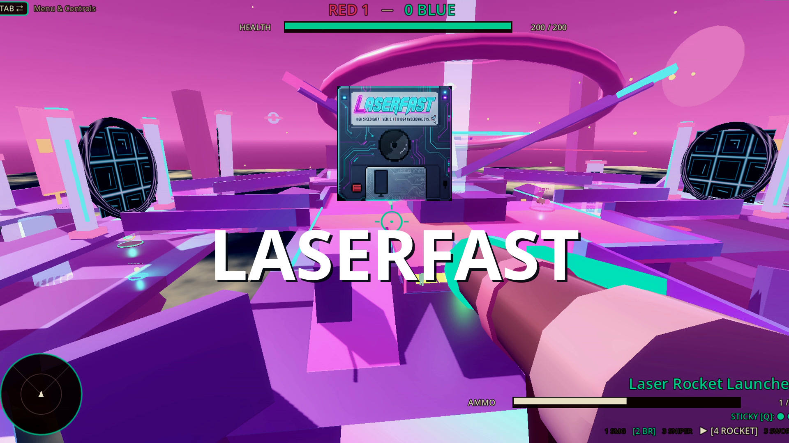

# LASERFAST

**A fast-paced, retro-inspired 3D Arena FPS built around old-fashioned fun and pure competitive gaming.**

 

*No battle passes. No pay-to-win loadouts. No bloated menus—just tight movement, power-weapon spawns, and instant arena combat.*

---

## Play & Download

| Platform | Link | Notes |
| :--- | :--- | :--- |
| **Web Browser** | [**Play at laserfast.net**](https://laserfast.net) | Instant play — zero download required |
| **Windows (64-bit)** | [**Download `LaserFast.exe`**](https://github.com/SubClimax-DJ/LaserFast-Downloads/releases/latest/download/LaserFast.exe) | Full desktop client + public/LAN server hosting |
| **Linux (64-bit)** | [**Download `LaserFast.x86_64`**](https://github.com/SubClimax-DJ/LaserFast-Downloads/releases/latest/download/LaserFast.x86_64) | Full desktop client + dedicated server support |

> **All Releases:** Browse previous builds and release notes on the [Releases Page](https://github.com/SubClimax-DJ/LaserFast-Downloads/releases).

---

## Promo & Showcase

| Promo Banner | Skyline Relay Showcase |
| :---: | :---: |
|  |  |

**[Watch the LaserFast Promo Video (`LaserFast_Ad.mp4`)](media/LaserFast_Ad.mp4)**

---

## Gameplay Screenshots

| Neon Canyon — Laser Battle Rifle | Skyline Relay — Laser Rocket Launcher |
| :---: | :---: |
|  |  |

---

## Features

* **Classic Arena Modes:**
  * **Slayer** — First-to-the-limit frag race.
  * **Capture the Flag (CTF)** — Coordinated pushes, flag runs, and last-second saves.
  * **Oddball** — Hold the ball, defend the carrier, rack up points.
* **6 Distinct Arenas:** Neon Canyon, Skyline Relay, Mainframe Cruiser, BlackICE Station, Reactor Coast, and Kitsune Shrine.
* **Power Weapons & Skill Duels:** Laser Battle Rifle, Laser SMG, Laser Sniper, Laser Rocket Launcher, Energy Laser Sword, and Sticky Grenades.
* **Competitive Feedback:** Instant hitmarkers, killfeed, medal badges, motion radar, scoreboard, and killcam replays.
* **24/7 Servers & Custom Hosting:** Jump into live lobbies with optional bot backfill, or host your own public/LAN server from the PC build.

---

## Controls

| Action | Key / Input |
| :--- | :--- |
| **Move** | `W` `A` `S` `D` |
| **Jump / Crouch** | `Space` / `C` or `Ctrl` |
| **Aim & Fire** | `Mouse` / `Left Click` |
| **Scope / Zoom** | `Right Click` |
| **Pick Up / Swap Weapon** | `E` |
| **Throw Sticky Grenade** | `Q` |
| **Reload** | `R` |
| **Scoreboard & Menu** | `Tab` / `Esc` |
