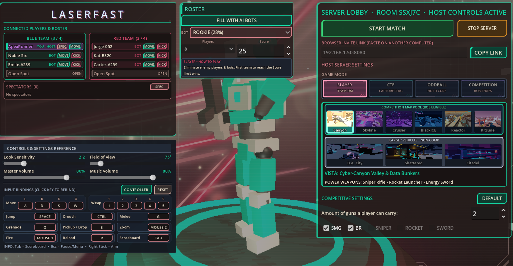
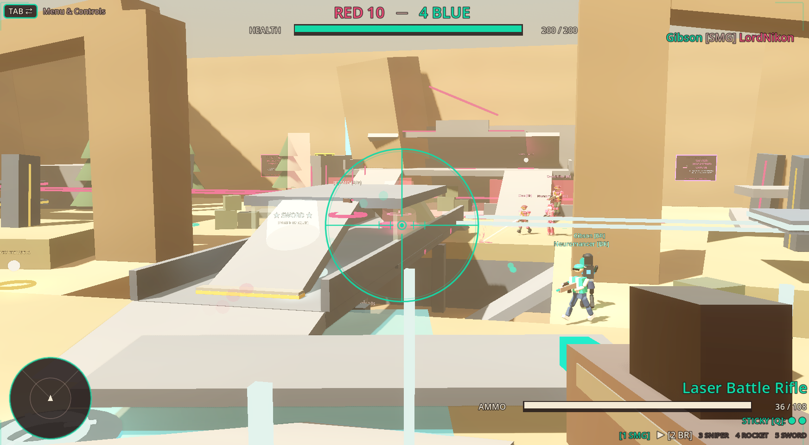
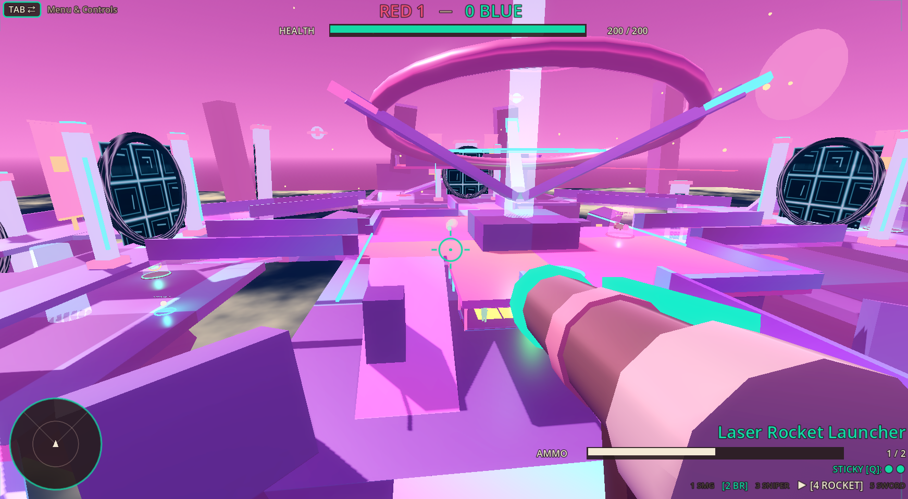

# LASERFAST

**LaserFast** is a fast-paced, retro-inspired **3D Arena FPS** built around **old-fashioned fun and pure competitive gaming**.

No battle passes, no pay-to-win loadouts, no bloated menus—just tight movement, map control, power-weapon spawns, classic game modes (**Slayer**, **Capture the Flag**, **Oddball**), and instant action in your browser or on PC.

---

## Play & Download

* **Play in Browser:** [**https://laserfast.net**](https://laserfast.net)
* **Windows (PC + Server Hosting):** [`LaserFast.exe`](https://github.com/SubClimax-DJ/LaserFast-Downloads/releases/latest/download/LaserFast.exe)
* **Linux (PC + Server Hosting):** [`LaserFast.x86_64`](https://github.com/SubClimax-DJ/LaserFast-Downloads/releases/latest/download/LaserFast.x86_64)
* **All Releases:** [Releases Page](https://github.com/SubClimax-DJ/LaserFast-Downloads/releases)

---

## Gameplay Screenshots

| Neon Canyon — Laser Battle Rifle | Skyline Relay — Laser Rocket Launcher |
| :---: | :---: |
|  |  |

---

## What's Included in the PC Builds

* Full **LaserFast** desktop client for **Windows** and **Linux**
* Built-in **host & dedicated server** support so you can run your own competitive lobbies and 24/7 map rotations
* Instant connection to public servers via the in-game server browser
